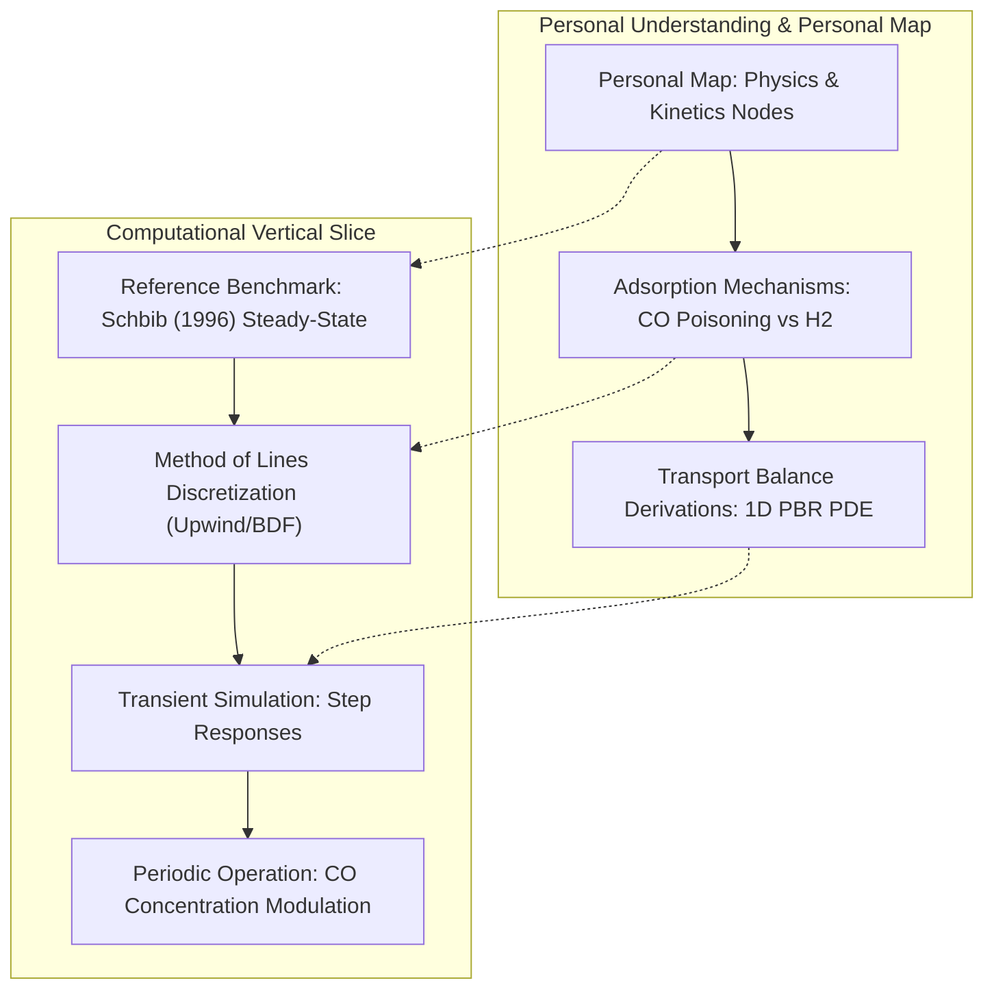

# BEP-Catalysis: Reactor Model Structure & Alignment Guide

This document captures the verified structural alignment for the Bachelor End Project (BEP), incorporating the direct instructions from the supervisor meeting (2026-10-23) and the literature grounding.

---

## 1. Supervisor Directives & Core Thesis Hypothesis

### Key Takeaways from Supervisor Meeting (2026-10-23)
* **Deliverable Priority:** Self-contained, runnable Jupyter notebook(s) + concise README that can be executed directly on standard Python environments without custom internal frameworks.
* **Two-Step Progression:**
  1. **Phase 1 (Steady-State Benchmark):** Reproduce published steady-state reactor performance (conversion, selectivity, temperature profiles) from literature.
  2. **Phase 2 (Transient & Periodic Operation):** Introduce dynamic balances and evaluate periodic operation.
* **The Core Thesis Topic — Carbon Monoxide ($CO$) Modulation:**
  - Hydrogen ($H_2$) modulation alone cannot surpass steady-state trade-offs due to kinetic constraints.
  - Carbon Monoxide ($CO$) is omnipresent in industrial acetylene tail-gas streams. Under these conditions, $CO$ does not react with $H_2$; it adsorbs reversibly and competitively on the active catalyst sites.
  - $CO$ acts as a selective moderator: it suppresses over-hydrogenation of ethylene ($C_2H_4$) to ethane ($C_2H_6$), substantially raising selectivity, but reduces overall activity (conversion).
  - **Research Hypothesis:** Periodic inlet modulation of $CO$ concentration enables dynamic tuning of surface coverage ($\theta_{CO}$), breaking the steady-state activity-selectivity Pareto front.

---

## 2. Pinned Literature Benchmark: Schbib et al. (1996)

### Reference Details
* **Title:** *Kinetics of Front-End Acetylene Hydrogenation in Ethylene Production*
* **Authors:** Noemí S. Schbib, Miguel A. García, Carlos E. Gígola (PLAPIQUI - UNS - CONICET)
* **Source:** *Industrial & Engineering Chemistry Research*, 35(5), 1496–1503 (1996).
* **DOI:** `10.1021/ie950600k`
* **Underlying Kinetics:** Primary kinetic experiments on commercial $\text{Pd}/\alpha\text{-Al}_2\text{O}_3$ with $150\text{--}5000\ \text{ppm}\ CO$.

### Governing Equations (1D Continuum Pseudohomogeneous Reactor)
1. **Component Mass Balance:**
   $$\varepsilon_b \frac{\partial C_i}{\partial t} = -\frac{\partial (u_z C_i)}{\partial z} + (1 - \varepsilon_b) \rho_s \sum_j \nu_{i,j} r_j$$
   *At Steady State:*
   $$\frac{\mathrm{d}(u_z C_i)}{\mathrm{d}z} = (1 - \varepsilon_b) \rho_s \sum_j \nu_{i,j} r_j$$

2. **Energy Balance (Adiabatic):**
   $$\left[\varepsilon_b \rho c_p + (1 - \varepsilon_b)\rho_s c_{p,s}\right] \frac{\partial T}{\partial t} = - u_z \rho c_p \frac{\partial T}{\partial z} + (1 - \varepsilon_b)\rho_s \sum_j (-\Delta H_{r,j}) r_j$$
   *At Steady State:*
   $$u_z \rho c_p \frac{\mathrm{d}T}{\mathrm{d}z} = (1 - \varepsilon_b)\rho_s \sum_j (-\Delta H_{r,j}) r_j$$

3. **Langmuir-Hinshelwood Kinetic Rate Laws with Competitive CO Adsorption:**
   $$r_1 = \frac{k_1 C_{\text{C}_2\text{H}_2} C_{\text{H}_2}}{\left(1 + K_{\text{H}}^{1/2} C_{\text{H}_2}^{1/2} + K_{\text{CO}} C_{\text{CO}}\right)^3}$$
   $$r_2 = \frac{k_2 C_{\text{C}_2\text{H}_4} C_{\text{H}_2}}{\left(1 + K_{\text{H}}^{1/2} C_{\text{H}_2}^{1/2} + K_{\text{CO}} C_{\text{CO}}\right)^3}$$
   where:
   $$k_j = k_{0,j} \exp\left(-\frac{E_j}{R T}\right), \quad K_i = K_{0,i} \exp\left(-\frac{E_{a,i}}{R T}\right)$$

### Pinned Numerical Parameters (Table 8 of Schbib 1996)
| Species / Reaction | Parameter | Pre-exponential factor | Activation Energy $E$ (kJ/mol) |
| :--- | :--- | :--- | :--- |
| **Acetylene Hydrogenation ($r_1$)** | $k_1$ | $\log_{10} k_{0,1} = 27.4\ \text{m}^6/(\text{kmol}\cdot\text{kg}_{\text{cat}}\cdot\text{s})$ | $190.42$ |
| **Ethylene Hydrogenation ($r_2$)** | $k_2$ | $\log_{10} k_{0,2} = 23.3\ \text{m}^6/(\text{kmol}\cdot\text{kg}_{\text{cat}}\cdot\text{s})$ | $179.66$ |
| **Hydrogen Adsorption** | $K_H$ | $\log_{10} K_{0,H} = 17.2\ \text{m}^3/\text{kmol}$ | $88.78$ |
| **Carbon Monoxide Adsorption** | $K_{CO}$ | $\log_{10} K_{0,CO} = 10.2\ \text{m}^3/\text{kmol}$ | $41.63$ |

---

## 3. Implementation Blueprint: Notebook & Map Co-Development

To ensure that the thesis author develops deep personal understanding and defends every equation in the committee review, we maintain two parallel tracks:

### Notebook Outline (`notebooks/unified_dynamic_reactor.ipynb`)
1. **Model Reference:** Working reference implementation of Schbib (1996) steady-state.
2. **Interactive Inspection:** Verification against published industrial profiles (conversion, selectivity, temperature).
3. **Discretization Engine:** Method of Lines (MOL) with backwards finite differences / Radau stiff solver.
4. **Dynamic Extension:** Transient mass & heat balances under inlet perturbation.
5. **Periodic Forcing Study:** CO square/sine wave inlet forcing and cyclic surface coverage response.

