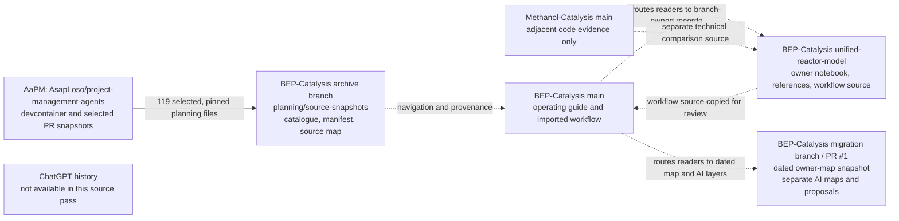

# BEP and AaPM source map

**Purpose:** navigate the scattered project-management, thesis, scientific-map,
workflow, and notebook records without flattening their ownership or status.
This is an index and provenance map. It does not reconcile decisions, promote
AI research into the personal map, update checklist status, or replace the
source archive.

## Repository and record map

Arrows describe source or navigation relationships. They do not imply an
automatic merge, current authority, scientific agreement, or permission to
edit another layer.

## Where to start

| Question | Start here | Authority and limits |
|---|---|---|
| What planning records were preserved from AaPM? | [Archive README](README.md), [119-file catalogue](CATALOGUE.md), and [source manifest](SOURCE_MANIFEST.json) | Selected immutable snapshots from AaPM; the source commits and original blob hashes are pinned in the manifest. This is not a whole-repository copy. |
| What workflow is proposed for BEP main? | [Open PR #25](https://github.com/AsapLoso/BEP-Catalysis/pull/25) and [workflow branch](https://github.com/AsapLoso/BEP-Catalysis/tree/codex/bep-guided-workflow-main-20261029), including its [root operating guide](https://github.com/AsapLoso/BEP-Catalysis/blob/codex/bep-guided-workflow-main-20261029/AGENTS.md) | Documentation is proposed for review. It is not proof of a working map-edit backend. |
| Where is the owner-authored notebook? | [Personal notebook](https://github.com/AsapLoso/BEP-Catalysis/blob/unified-reactor-model/notebooks/unified_dynamic_reactor.ipynb) and [notebook index](https://github.com/AsapLoso/BEP-Catalysis/blob/unified-reactor-model/notebooks/README.md) | The notebook remains on unified-reactor-model; reference, AI, legacy, and benchmark notebooks stay distinct. |
| Where is the dated owner-map snapshot? | [Owner map, 2026-10-22](https://github.com/AsapLoso/BEP-Catalysis/blob/migration/bep-map-consolidation-20261023/research/manual_map_sessions_2026_10_22/owner_working_map/current_map.yaml) | A dated snapshot on the open [migration PR #1](https://github.com/AsapLoso/BEP-Catalysis/pull/1), not a guarantee that this is the newest owner-approved copy. Re-check current authority before any edit. |
| Where is AI-generated scientific research? | [Integrated reference map](https://github.com/AsapLoso/BEP-Catalysis/tree/migration/bep-map-consolidation-20261023/research/integrated_reference_map_2026_10_22), [independent reference map](https://github.com/AsapLoso/BEP-Catalysis/tree/migration/bep-map-consolidation-20261023/research/independent_reference_map_2026_10_21), and [comparison/reconciliation proposals](https://github.com/AsapLoso/BEP-Catalysis/tree/migration/bep-map-consolidation-20261023/research/map_comparison_reconciliation_v3_2026_10_23) | AI-authored claims, hypotheses, and proposed reconciliations remain separate from the owner map. Comparison files are proposals, not approved owner changes. |
| Where is the mind-map application and its operating context? | [Migration PR #1](https://github.com/AsapLoso/BEP-Catalysis/pull/1), including its mindmap tree and [map README](https://github.com/AsapLoso/BEP-Catalysis/blob/migration/bep-map-consolidation-20261023/mindmap/README.md) | The migration proposal is not merged to main. Review its current head and scope before relying on implementation details. |
| What is the connection to Methanol-Catalysis? | [AsapLoso/Methanol-Catalysis](https://github.com/AsapLoso/Methanol-Catalysis) | Adjacent code source only. No files from it were imported or validated in this pass; it is not the destination for BEP planning or personal-map records. |

## Workflow files proposed for main

The [guided science skill](https://github.com/AsapLoso/BEP-Catalysis/blob/codex/bep-guided-workflow-main-20261029/.agents/skills/bep-guided-science-loop/SKILL.md),
[map-edit review skill](https://github.com/AsapLoso/BEP-Catalysis/blob/codex/bep-guided-workflow-main-20261029/.agents/skills/bep-map-edit-review/SKILL.md),
[session-handoff skill](https://github.com/AsapLoso/BEP-Catalysis/blob/codex/bep-guided-workflow-main-20261029/.agents/skills/session-handoff/SKILL.md),
[reversible-change skill](https://github.com/AsapLoso/BEP-Catalysis/blob/codex/bep-guided-workflow-main-20261029/.agents/skills/reversible-change-review/SKILL.md),
[backend contract](https://github.com/AsapLoso/BEP-Catalysis/blob/codex/bep-guided-workflow-main-20261029/research/workflows/bep_conversational_map_backend.md),
and [execution handoff](https://github.com/AsapLoso/BEP-Catalysis/blob/codex/bep-guided-workflow-main-20261029/research/workflows/BEP_EXECUTION_HANDOFF_2026_10_29.md)
are being carried from the reactor branch at source commit
[d1b1a146](https://github.com/AsapLoso/BEP-Catalysis/commit/d1b1a14698ca9a235942ec83cf99704836f1acbe).
The files have been adapted only where a link or destination would otherwise
be broken or misleading on main. The backend contract and handoff both say
that an operational writeback system is **not yet verified or complete**.

## Related BEP pull requests

Statuses below were checked on **2026-10-29**; follow each link for live state.

| PR | Status and scope | Relationship to this map |
|---|---|---|
| [#1 — mind-map and reference migration](https://github.com/AsapLoso/BEP-Catalysis/pull/1) | Open draft; migration branch to main. Includes the dated owner map, separate AI maps/proposals, and the mind-map application. | Keep all map layers distinct; no scientific content is promoted by this navigation page. |
| [#2 — AaPM planning archive, phase 1](https://github.com/AsapLoso/BEP-Catalysis/pull/2) | Open; archive branch to main. Preserves selected source snapshots without consolidation. | This source map is an additive companion on the archive branch. |
| [#7 — lossless task occurrence backlog](https://github.com/AsapLoso/BEP-Catalysis/pull/7) | Open draft; separate branch targeting the archive branch. | Preserve as separate work; do not rewrite the backlog into this map. |
| [#22 — owner-led science workflow](https://github.com/AsapLoso/BEP-Catalysis/pull/22) | Merged into unified-reactor-model. | Workflow source carried to main in a separate review branch. |
| [#23 — proactive execution handoff](https://github.com/AsapLoso/BEP-Catalysis/pull/23) | Merged into unified-reactor-model. | Handoff source carried to main in a separate review branch; it still reports the backend as incomplete. |
| [#25 — guided workflow documentation on main](https://github.com/AsapLoso/BEP-Catalysis/pull/25) | Open; documentation branch to main. | Adds the workflow only; no notebook, map data, application code, or operational backend changes. |

## AaPM archive provenance

The archive was captured on **2026-10-23** from
[AsapLoso/project-management-agents](https://github.com/AsapLoso/project-management-agents)
and staged in
[archive/aapm-bep-planning-maps-20261023](https://github.com/AsapLoso/BEP-Catalysis/tree/archive/aapm-bep-planning-maps-20261023/planning).
The manifest records the source commits:

- AaPM devcontainer snapshot: 8c48cf8a5ba5b3d02dcd1787f98abcd65b34c5c8
- AaPM PR #50 snapshot: 5247476df62a4f5c64ddc804fff7ee575f1758eb
- AaPM PR #180 snapshot: 21043c63cefcd64cb80280176927c49769ead459
- AaPM PR #182 snapshot: 81b0c6e61f1802023fc7244ac329ee2e88ae7c63
- AaPM PR #186 snapshot: 2296d8e0eb9aee94c267df2fde51d4b845ac884d
- AaPM PR #188 snapshot: a1b3898dffd3df0b2c58d1a1a6b2936765f2218d
- AaPM PR #199 snapshot: 5b07f0e98ceebc20f6f217ff0571326f0c3feae7

The imported set contains 119 selected files. Sixteen source copies replace
machine-specific Windows path prefixes with portable placeholders; the
manifest preserves each original source location and blob hash. The archive
does not include all scientific data, PDFs, raw inbox material, notebooks, or
complete commit and PR review histories. Follow its pinned source links when
those are needed. PR states named by the manifest are historical snapshot
labels; check GitHub for current status.

## Reading and editing rules

1. Resolve the repository and branch before acting. Read-only source snapshots
   under planning/source-snapshots/ preserve provenance; do not edit them as
   if they were current project files.
2. Keep project planning, scientific knowledge, owner approval, and AI
   interpretation distinct. The archive's phase-two integration procedure is
   explicitly **not started**; this map does not execute it.
3. Treat the dated owner map as a pointer to a candidate source, not proof of
   current authority. Re-check the latest owner-approved branch and blob
   before any personal-map write. AI maps and comparison proposals never
   promote themselves into the owner graph.
4. Keep the owner notebook on unified-reactor-model separate from AI,
   legacy, and benchmark implementations. Work in it only after the owner
   chooses the formulation and the current saved file is confirmed.
5. Use the workflow skills for human-reviewed, scoped changes. Documentation,
   a passing parser, or a proposed PR is not evidence that a live backend or
   scientific result has been validated.
6. ChatGPT history was not available in this source pass. This map therefore
   covers the inspected GitHub records and makes no claim that all
   conversations or notebooks have been captured.

## Repository heads checked on 2026-10-29

- BEP-Catalysis main: 0cf25e8f055d056070b80663c188d44aa088a65b
- BEP-Catalysis archive branch: e011f89ce2ff5c0cf5c1d20382ad0b380d588716
- BEP-Catalysis migration/bep-map-consolidation-20261023:
  4a419354837486f65e00f26236826125b97e9b5b
- BEP-Catalysis unified-reactor-model:
  d1b1a14698ca9a235942ec83cf99704836f1acbe

These are inspection-time references, not a statement that the branches remain
unchanged. Refresh the branch heads and PRs before work that depends on current
state.
