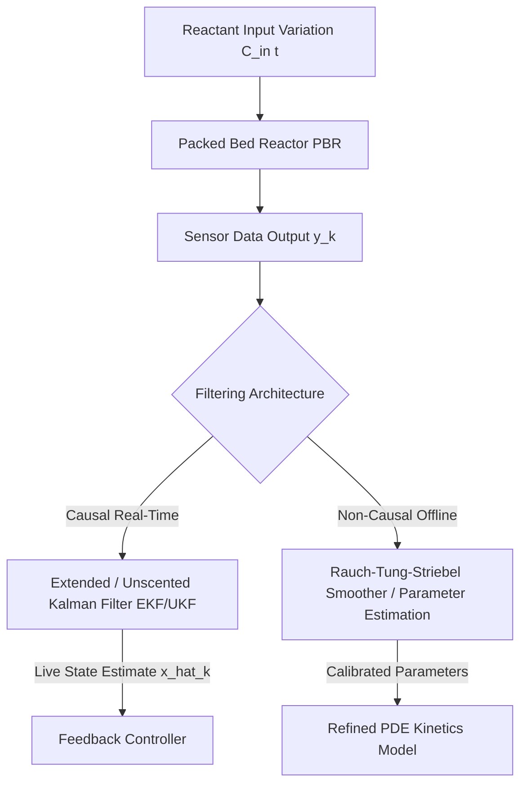
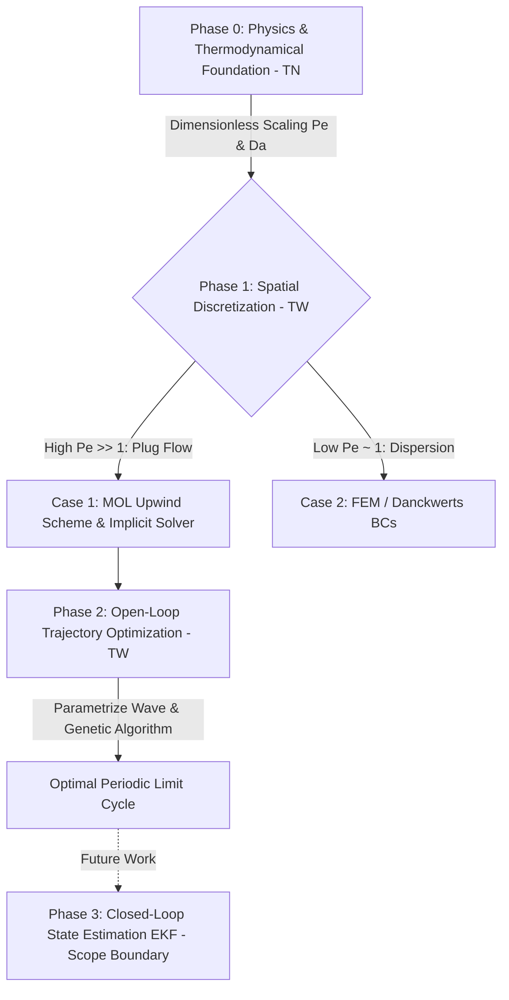

# Proposal & Research Roadmap: Model-Based Control and State-Space Optimization in Packed Bed Reactors

**Author:** Lucas van Dekken  
**Supervisors:** Zoë Gromotka (Applied Mathematics), Damian Vico Van Berkel (Urakawa Group / Applied Physics), Dr. Dylan Kalisvaart (Systems & Control)  
**Target:** Dual BSc End Project (Applied Physics & Applied Mathematics)

---

## Executive Summary & Strategic Approach

This project addresses the challenge of **maximizing yield and selectivity** in sequential catalytic reactions—specifically **acetylene semi-hydrogenation** ($C_2H_2 \xrightarrow{k_1} C_2H_4 \xrightarrow{k_2} C_2H_6$)—by dynamically manipulating time-varying reactant input concentrations $C_{\text{in}}(t)$.

Rather than relying purely on empirical data fitting, this project builds a **rigorous mathematical and physical framework**. Recognizing that solving full 1D spatial + 1D temporal non-linear PDEs inside a live closed-loop control framework is an ambitious multi-year scope, this thesis will deliver:
1. **Rigorous Physical Modeling & Simulation:** A full 1D non-linear PDE model coupling transport phenomena (dispersion, intra-particle mass transfer) with reaction kinetics.
2. **System & Stability Analysis:** Jacobian matrix evaluation around steady states and exploration of cyclic/periodic state-space trajectories.
3. **Estimation & Filtering Dichotomy:** Evaluating Causal (live EKF/UKF) vs. Non-Causal (offline smoothing/calibration) state estimation.
4. **Authoritative Research Roadmap:** A mathematically sound blueprint mapping out immediate Bachelor scope vs. future research trajectories.

---

## 1. Physical & Kinetic Foundation (Coupled Non-Linear PDEs)

### 1.1 Sequential Reaction Chain & Selectivity Challenge
Ethylene ($C_2H_4$) is an intermediate reactant in a sequential chain:
$$C_2H_2 + H_2 \xrightarrow{r_1} C_2H_4 + H_2 \xrightarrow{r_2} C_2H_6$$
The primary objective is to maximize the net rate of $C_2H_4$ production while preventing over-hydrogenation to $C_2H_6$.

### 1.2 1D Convection-Dispersion-Reaction Model
The bulk fluid concentrations $C_i(z,t)$ for $i \in \{C_2H_2, H_2, C_2H_4, C_2H_6\}$ across axial position $z \in [0, L]$ and time $t \ge 0$ obey:
$$\frac{\partial C_i}{\partial t} = D_{\text{ax}, i} \frac{\partial^2 C_i}{\partial z^2} - u \frac{\partial C_i}{\partial z} - \frac{1-\varepsilon}{\varepsilon} a_v k_{c, i} \left( C_i(z,t) - C_{p, i}(z, R_p, t) \right)$$

### 1.3 Intra-Particle Mass Balance (Porous Media)
Inside spherical catalyst pellets ($r \in [0, R_p]$):
$$\varepsilon_p \frac{\partial C_{p, i}}{\partial t} = D_{\text{eff}, i} \left( \frac{\partial^2 C_{p, i}}{\partial r^2} + \frac{2}{r} \frac{\partial C_{p, i}}{\partial r} \right) + \rho_p R_i(\mathbf{C}_p, T)$$

---

## 2. System Analysis & Stability (Jacobian & State-Space)

### 2.1 Equilibrium & Jacobian Formulation
For static inputs $C_{\text{in}}(t) = \bar{C}$, the system settles to a steady-state profile $\bar{\mathbf{C}}(z, r)$. 
Linearizing the discretized state vector $\mathbf{x}(t)$ around equilibrium yields the system Jacobian:
$$\mathbf{J} = \left. \frac{\partial f(\mathbf{x}, \mathbf{u})}{\partial \mathbf{x}} \right|_{\bar{\mathbf{x}}, \bar{\mathbf{u}}}$$
Evaluating the eigenvalues $\lambda(\mathbf{J})$ determines natural asymptotic stability and local stiffness.

### 2.2 Dynamic Pulsing & Cyclic Steady States
By applying time-varying input concentrations $u(t) = C_{\text{in}}(t)$, we intentionally drive the system **out of static equilibrium**. We seek **cyclic limit trajectories** in state-space:
$$\mathbf{x}(t + T_{\text{pulse}}) = \mathbf{x}(t)$$
which yield a higher time-averaged selectivity $\bar{S}_{C_2H_4}$ than any static equilibrium point.

---

## 3. Parameter Estimation & The Filtering Dichotomy

### 3.1 Causal Filter (Real-Time Live Feedback)
* **Approach:** Extended Kalman Filter (EKF) or Unscented Kalman Filter (UKF) operating on a reduced-order / spatially discretized state vector.
* **Advantage:** Computes estimates $\hat{\mathbf{x}}_k$ using only current and past measurements ($y_0 \dots y_k$), allowing live closed-loop control during experiments.

### 3.3 Grey-Box System Identification & Control-Oriented Reduced Models
* **The High-Fidelity Trap:** Identifying a 100% accurate non-linear loss landscape requires non-convex black-box ML, which forfeits physical insight and computational speed.
* **Control-Oriented Grey-Boxing:** Enforce physical conservation laws (1D mass balances, Arrhenius structure) while aggregating parameters (e.g., $k_{\text{eff}}, k_c, \text{Pe}$).
* **Gradient Direction > Perfect Prediction:** Robust control theory guarantees that as long as the model gradient $\nabla S(u)$ correctly points toward higher selectivity, closed-loop feedback (Kalman tracking) nudges the real reactor toward the true physical optimum without needing high-fidelity prediction.

---

## 4. 4-Phase Technical Execution Framework

### Phase 0: Physics & Thermodynamical Foundation (Applied Physics / TN)
* **Full Transport Equations:** 1D Convection-Dispersion mass balances coupled with surface kinetic rate laws (Langmuir-Hinshelwood) and exotherm energy balances (Arrhenius temperature dependence).
* **Dimensionless Analysis:** Scale mass/heat balances using reactor physical parameters to derive dimensionless numbers ($Pe, Da$). Prove physically and mathematically that axial dispersion is negligible ($Pe \gg 1$), securing the TN physics grade.

### Phase 1: Spatial Discretization & Solver Architecture (Applied Math / TW)
* **Case 1: High Péclet Number ($Pe \gg 1$, Primary Track):** Neglect axial dispersion. Hyperbolic PDE discretized via **Method of Lines (MOL)** with an **Upwind Finite Difference Scheme** ($x_i$ depends strictly on $x_{i-1}$).
* **Case 2: Low/Medium Péclet Number ($Pe \approx 1$, Contingency Track):** Retain 2nd-order dispersion. Discretize via Orthogonal Collocation or Finite Elements with Danckwerts boundary conditions.
* **Time Integration:** Solve stiff coupled ODEs using implicit solvers (BDF / Radau in `scipy.integrate.solve_ivp`).

### Phase 2: Open-Loop Trajectory Optimization (Applied Math / Systems & Control)
* **Objective Function:** Maximize time-integrated intermediate ethylene yield $\int_0^T Y_{C_2H_4}(t) dt$.
* **Input Wave Parametrization:** Represent input concentration $C_{\text{in}}(t)$ via splines, Fourier components, or pulse trains.
* **Optimization Algorithm:** Optimize wave parameters using **Genetic Algorithms (GA)** or **Dynamic Programming** to discover optimal state-space periodic limit cycles.

### Phase 3: Closed-Loop Control & Filtering (Explicit Future Work Boundary)
* Formulate state observer / Extended Kalman Filter (EKF) to track catalyst surface coverage $\theta(x,t)$ from boundary measurements. Formally scoped as **Future Research / Ph.D. Roadmap**.

---

## 5. Scoping & Bachelor Thesis Deliverables

| Component | In-Scope for BSc Thesis | Future Work / Ph.D. Roadmap |
| :--- | :--- | :--- |
| **Physical Model** | 1D Discretized PBR PDE + intra-particle diffusion + dimensionless analysis ($Pe$) | 2D/3D CFD reactor thermal-fluid coupling |
| **Stability Analysis** | Jacobian formulation $\mathbf{J}$, static equilibrium & periodic limit cycle evaluation | Global bifurcation analysis of limit cycles |
| **Control & Pulsing** | Open-loop periodic trajectory optimization via Genetic Algorithm / Dynamic Programming | Live hardware-in-the-loop closed-loop control |
| **Filtering & Estimation** | Offline parameter calibration & state estimation formulation | Full real-time embedded EKF deployment |
