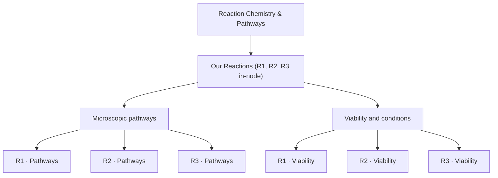
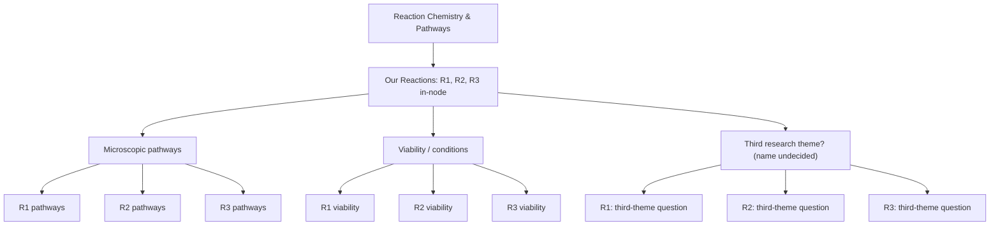

> **APPLIED RESET AFTER THIS DESIGN DISCUSSION (2026-10-22):** The two-theme/six-question scheme remains the **chosen research navigation design**, but is **parked as candidate bridges** rather than live personal-map content. Four prior reaction-science nodes have been archived and removed from the personal YAML; only BEP and its three discipline anchors remain. All six individual reaction questions are **Idea, not placed** even where the separate AI reference map has full draft explanations. Owner wants to restart with an explanation of each candidate before any new insertion. For diagrams, show just the current theme (parent) and its three R1–R3 questions; label stages in words, not colors. The full diagrams below are historical design illustrations, NOT the current personal graph or a suggested chat display.

# BEP owner map — research themes as graph branches; one progress unit per question

**Captured:** 2026-10-22, owner-led design clarification.  
**Status:** authoring/design insight; **not** a mutation of `current_map.yaml` or approval of scientific content.  
**Applies to:** `BEP → Physics → Reaction Chemistry & Pathways`, and reusable as a rule for later map branches.

## Latest owner correction — TWO themes only (2026-10-22)

**Current design, superseding the historical nine-slot exploration below:** The owner explicitly decided **not to invent a third category**. The two genuine scientific research themes are:

1. **Microscopic pathways**: specific microscopic/surface mechanisms that may produce each net conversion.
2. **Viability and conditions**: source- and reactor-dependent conditions under which routes are physically plausible or significant.

`Reaction Chemistry & Pathways → Our Reactions` contains the three net equations **in the container's node information**, then has precisely the **two** theme branches above. Each theme offers independent R1/R2/R3 progress units; at this depth **2×3 = six question slots**, not nine. R3 may legitimately remain Idea while R1 is AI-worked-out. This is the structural design direction, **not** a claim that the current eight-node `current_map.yaml` has already been migrated.

**General operating insight survives:** create distinct navigable nodes only when research/understanding/writing progress can differ, not just because a paper lists several facts; keep detailed source evidence inside nodes. The historical *nine-slot* proposed graph preserved below is **superseded**, not a requirement for subsequent agents. The frontend must support arbitrary depths and numbers of categories, never assume two or three theme branches exist globally.

## Historical nine-slot exploration (superseded for this branch)

## Why we changed the design

The map is **not an encyclopedia outline** and not a graphical rendering of every sentence. It shows **which scientific questions we choose to investigate, and how far the owner has progressed with each one**. Two questions deserve separate nodes if their work, understanding, or writing maturity can evolve independently.

A single combined mechanism/viability/evidence record for all three reactions cannot honestly be assigned one stage if, for example, R1 is understood well and R3 remains an Idea. The owner explicitly observed that we may need **nine progress units**, since the three dimensions can be researched differently for each reaction and R3 may remain incomplete.

**Rule:** promote *a question/theme* to a map node when it is worth independently revisiting, researching, understanding, citing, or writing. Keep elementary details, equations, alternative micro-steps and citations **inside a node** unless they themselves require separate progress tracking. The node's status refers only to its bounded question, never its parent, sibling, or attached sources.

## The theme-first pattern

The owner corrected the previously displayed hierarchy. Under **Reaction Chemistry & Pathways**, use an **Our Reactions** reference/container, with R1/R2/R3 identified **once in its node content**:

- **R1:** C₂H₂ + H₂ → C₂H₄ (acetylene semi-hydrogenation)
- **R2:** C₂H₄ + H₂ → C₂H₆ (ethylene over-hydrogenation)
- **R3:** C₂H₂ + 2H₂ → C₂H₆ (overall acetylene-to-ethane conversion); stoichiometrically R3 = R1 + R2, not proof of an independent microscopic channel

Make the **themes of investigation** the explicit graph branches rather than forcing R1/R2/R3 to be the only immediate graph branches:

1. **Microscopic reaction pathways** — which surface routes/intermediates could realize the net conversion?
2. **Viability and operating conditions** — when are those routes physically plausible or important for a *specified* catalyst and regime?
3. **Kinetic models and supporting evidence** — possible third dimension offered by the assistant, **NOT recovered or approved as the owner's exact third theme**. Naming/content must be reviewed before canonical insertion.

If progress is to be tracked separately, a theme may have **R1-specific, R2-specific, R3-specific research-question children**. The owner has **returned to the nine-unit design**: at full research-tracking resolution, 3 themes × 3 reactions = **nine intended independently assessable question slots**, **not nine automatically approved graph nodes, required positive findings, or nine completed scientific conclusions**. The third theme's exact title/scope still requires a separate decision.

The nine leaf nodes are the **agreed target tracking granularity**, once the themes and exact placements have been approved. Add a real personal-map node only through a scoped owner-authorized edit; a nonexistent node is not automatically an Idea in the approved graph. An approved but unresearched unit can remain Idea indefinitely. Never automatically advance status when an AI researches sources.

## Authoring and progress protocol

- On each map step, identify **which specific scientific question** is the current unit, not merely which paper, reaction formula, or textbook subsection is open.
- Record **one** independent maturity/writing stage per such unit: `Idea → AI worked out → Human worked out → Informal Writing → Formal Writing` (conceptual five-stage target; the legacy app has not safely migrated to it).
- Independently record placement approval, owner's reading/content review, and each claim's **AI-vs-human citation verification**. No inference from one dimension to another.
- Use sources/claims/evidence excerpts and exact reference-map node/claim IDs **inside node metadata**. Do not create an obligatory source-node or one node per quote.
- Link shared mechanisms across R1/R2/R3 by stable references, not duplicated and divergent scientific explanations.
- Revisit whether a node needs splitting **when actual research progress diverges**, not merely because there are several facts in its notes.
- During a manual session, discuss and log one bounded question, then choose to deepen, return to siblings, or park the research. Do not quiz for trivial knowledge or auto-promote human understanding.

## Reconciliation with files already present

**As of this design note, `current_map.yaml` still has 8 nodes** and the older three sibling categories under `Reaction Chemistry & Pathways`. The exact theme-first reparenting and any new nodes are **not implemented**. Existing stable IDs, owner structure decisions, scientific notes and citation links must be preserved during a later reviewed migration; avoid treating the old layout as the newly agreed graph.

The R1–R3 Wayfinder tickets in `research/wayfinder/bep_reaction_pathway_evidence_2026_10_22.md` and bridge records `B-R1`, `B-R2`, `B-R3` remain **open source-research ideas**. They can supply reference material to theme-by-reaction work units; they are not proof that those nine personal nodes exist or are understood. The AI reference research branch and citation audit remain separate.

**Next owner conversation:** settle the exact *third* research dimension; then show a narrow ID-preserving tree diff before making any personal-map structural change. No source or personal scientific-status promotions are authorized by this document.
