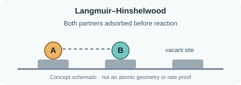
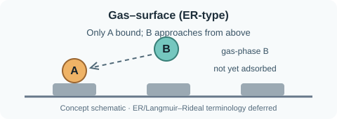

# Surface Reaction Encounter Mechanisms

Three different descriptions of **how two reacting partners meet** on or near the catalyst. This is different from the *hydrocarbon intermediate route* and from *which gas-pressure dependence is fitted*. Maturity, tier and parentage are read from `current_map.yaml`, not this explanatory page.

### Langmuir–Hinshelwood (LH): both reactants chemisorbed

Both reactants occupy suitable surface sites before the elementary reaction. In one specific supported-Pd model, acetylene-derived adsorbates react with activated adsorbed H. One simplified forward rate is `r_s = k_s θ_A θ_H`, but this is **an AI reference illustration**, not the exact BEP rate law. Gas-pressure reductions depend on the adsorption/site-balance assumptions.

### Langmuir–Rideal (LR): direct gas–surface encounter

A reactant in the gas phase strikes a chemisorbed surface partner and reacts **without first occupying an equilibrated surface-adsorption state**. A fixed-temperature illustrative rate may look like `r_s = k_LR θ_A p_B`, with proper units and collision assumptions.

### Eley–Rideal (ER), in the stricter sense: weakly physisorbed plus chemisorbed

A reactant binds only weakly near the surface and reacts with a chemisorbed partner. This is distinct from the direct gas arrival of LR. An illustrative elementary rate can involve `θ_A θ_B,phys` and under further low-coverage equilibrium assumptions may become pressure-dependent. **The gas-approach SVG shown above does not demonstrate physisorption and should not be misrepresented as a strict ER diagram.**

### Evidence and maturity

Our personal-map mechanism families and their three subdivisions (encounter, illustrative rate, assumptions) are currently **Ideas**, with more detailed AI notes and references available. This intentionally does **not** mean the literature mechanisms lack a scientific basis; it means the owner has not accepted a comprehensive BEP-specific mechanism assessment yet. **No direct LR or strict ER mechanism has been demonstrated for our target PdAg catalyst.**

[Kiani & Wachs (2024), *ACS Catalysis*, DOI 10.1021/acscatal.4c05188](https://doi.org/10.1021/acscatal.4c05188), Introduction and Sections 2–3, explicitly distinguish LH, LR and strict ER, and explain why rate-law fits alone often cannot identify the encounter mechanism. [Urmès et al. (2019), *Catalysts*, DOI 10.3390/catal9020180](https://doi.org/10.3390/catal9020180), Table 3, gives an LH-type supported-Pd example, not confirmed as our fitted PdAg kinetics. Both sources are AI-reviewed, **not human-verified**.

The two SVGs are original educational illustrations, not molecular structures, primary scientific figures or proof of catalyst behavior. Diagram rendering in the separate frontend remains untested.

**Question for Damian:** What surface reaction mechanism and kinetic closure are assumed in our actual code, and which choices are experimentally supported rather than fitted?
