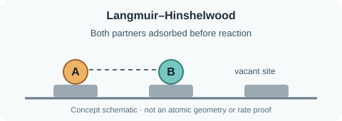

# Langmuir–Hinshelwood (LH)

Both reacting partners adsorb before reacting. For a supported-Pd *model*, one might have an adsorbed hydrocarbon and an adsorbed H atom (formed by H₂ dissociation).

### The three existing subtopics

**Elementary encounter:** The reacting partners are surface-bound; the actual species and neighboring-site requirements depend on the chosen mechanism.

**Illustrative surface rate:** `r_s = k_s θ_A θ_H`; θ_A and θ_H are fractions of sites occupied by compatible reacting species. This *simplified forward mean-field rate* is explicitly an **AI-derived illustration** from pinned reference `ph_lh_rates`, not a verbatim equation or a fitted BEP law.

**Assumptions:** Surface site balance, suitable adsorption/activation steps, rate-determining step and possible quasi-equilibrium coverages are needed to derive a particular pressure law. Some kinetics models have one effective site family; others have two or more. A reversible net rate may need reverse terms and detailed balance.

### Evidence versus owner stage

Urmès et al. (2019) provide a source-specific one-effective-site-family supported-Pd LH-type mechanism and rate derivation: [*Catalysts* 9(2), 180, Table 3 and kinetic derivation](https://doi.org/10.3390/catal9020180). Our pinned AI graph `ph_lh_rates`, `ph_mechanism_choice` and `c2_urmes_2019_effective_rates` holds more detailed scientific notes.

The personal-map stage of LH and its three children is **Idea at the owner's latest request**. That indicates incomplete owner-approved BEP-specific explanation, **not absence of published science**. The owner tentatively expects their working model uses LH; exact fitted model/code remains to be checked. No source is human verified.

Arrhenius dependence of reaction coefficients (and possible temperature-dependent adsorption constants) remains a cross-disciplinary connection to the Mathematics → Mathematical Modeling branch, not another LH encounter type.
